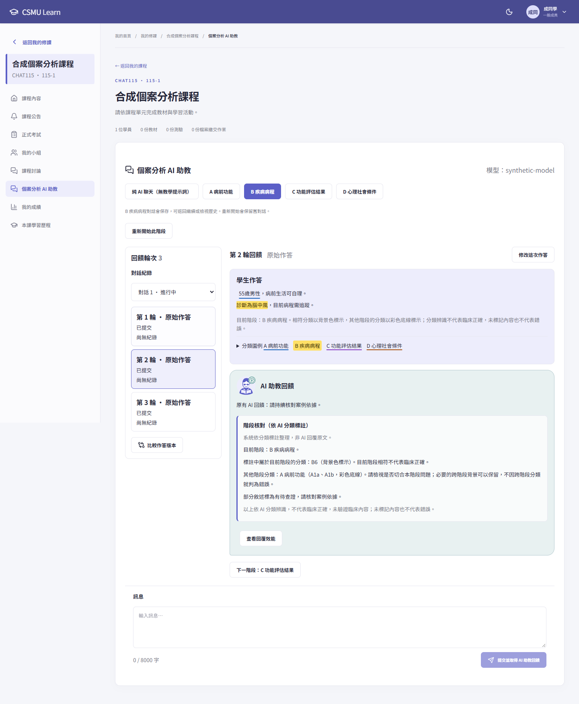
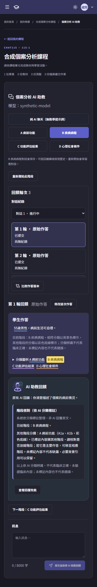
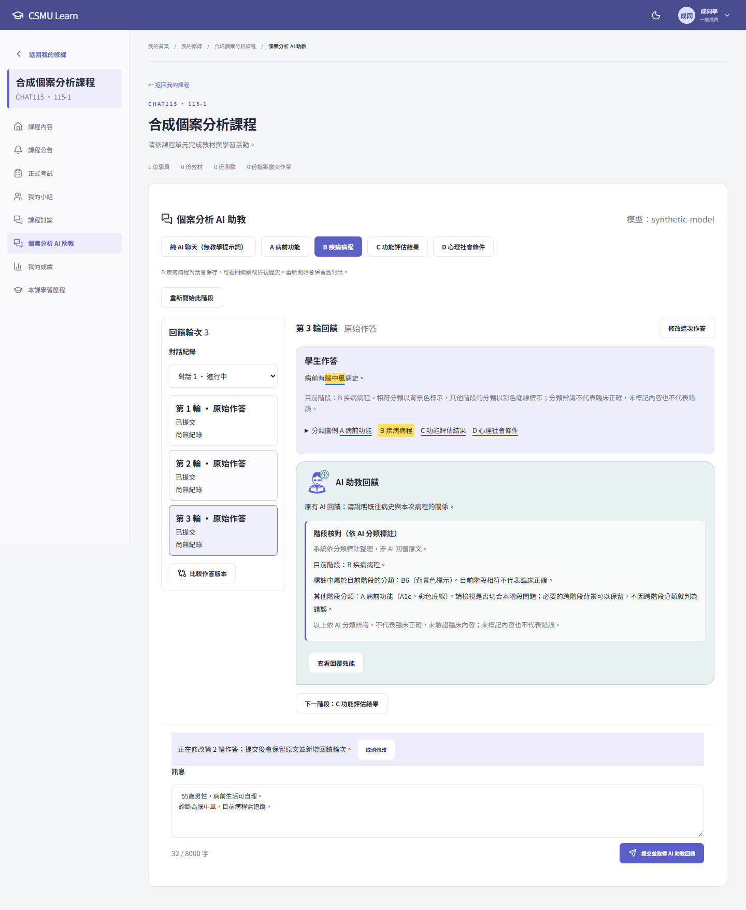

# 四階段原文分類標註

## 2026-11-16 相符標記統一黃色（最新）

使用者反映低透明度phase色與容器衝突，目前階段相符內容及圖例改為不透明黃色#ffe066、深色字#332a00，淺深模式一致；篩選淡化用#e6dca7仍保留字色對比。其他phase底線保留，多碼重疊可在黃底畫線；黃底內使用較深版phase色以免深色主題淺色底線消失。黃色只代表目前階段分類相符，不是臨床正確。相關Vue10、Chrome4、Vite及手機深色視覺核對通過；沒有後端或DB改動。

## 2026-11-16 目前階段相符與其他階段（現行）

依使用者新要求，明確傳入伺服器選定／已儲存作答的stage：例如目前B疾病病程，辨識為B的原文用黃色背景，辨識為A／C／D的原文仍用該階段彩色底線；同片段有合理多碼時背景與底線並存。圖例標出目前階段，tooltip保留每碼、分類位置與unverified／unsupported／misplaced的證據限制。沒有有效stage的舊呼叫維持細底線，Raw仍不使用此元件。

CaseChat及Studio回饋區新增「階段核對（依AI分類標註）」；明示系統依標註整理、不是AI原回覆。只使用通過exact-text驗證的該版標註，列出目前階段及其他分類，提示核對是否放錯位置；未標記不代表缺漏，必要跨階段背景可以保留，不強迫補資料、不自動扣分。舊AI文字與DB metadata不改寫，沒有新Migration。

此規則取代最初「所有分類一律只有底線」的顯示。背景代表與目前階段的**分類相符**，不是答案／診斷正確，不能作成績依據。新回歸包含B內A、B內B、合法A/B同範圍、多版本／教師、未標記本階段內容及淺深色／手機。

## 架構與歷程

課內 CaseAnalysisChat 維持四階段／每輪 user 與 assistant 配對。新增的內部模型 envelope 包含 `feedback` 與 `annotations`，公開 `content` 仍是回饋文字，新增選用 `annotations`。039只增加 nullable JSONB metadata及原不可變 trigger 的保護欄位；同一交易保存 assistant 的回饋、效能及標註，`in_reply_to` 固定對應送出原文。不重算歷史標註，不改舊答案或成績。

既有案例學習 Studio 沿用 summary／supportedPoints／improvements／nextSteps 及既有 JSON 欄位儲存，追加選用 annotations；用 answerVersionId、儲存的 answer.Text 驗證，無額外Studio migration。既有案例版本的 Material 作為獨立 caseFacts，不與學生原文混用。Raw Chat 不產生標註、無新 schema／DB／統計。

`CaseCodingCatalog` 為唯一43碼目錄，由已授權的配置／StudioCase DTO提供前端。沒有 A2c、B2c、C5子碼、A4未核定子碼或第五分析階段。

## 格式與驗證

保存後每筆：`annotationId, start, end, text, codes[], explanation, status`。ID由伺服器產生，phase由代碼目錄推導，允許同範圍跨phase多碼。start為0起算UTF-16 code unit，end exclusive；與.NET字串／JavaScript slice一致。

實際模型無法可靠計算索引，因此AI專用schema使用`text, occurrence, codes, explanation, status`：text逐字引用解碼後answerText，occurrence明確指定該片語0起算出現次序（重疊亦計次）。伺服器以Ordinal完全相同搜尋取得UTF-16範圍；不是先接收錯誤offset再猜位置修補。明確指定不存在的出現次序、改寫文字或同筆混用occurrence與start/end均拒絕。後端仍能驗證舊numeric表示，公開輸出及前端只收標準範圍，沒有破壞舊歷程。最新user僅在Stage Provider內包成answerText及格式提醒，原始DB內容與Raw封包不變。

後端CaseAnnotationContract及前端caseAnnotations均驗證整數範圍、完整代理對邊界、原文substring完全相同、已核定代碼。不用trim／正規化、不搜尋替代位置，不因重複片語而改標另一處。錯誤標註丟棄而保留有效文字回饋；壞envelope則保留原作答供重試，不保存假成功。最多48筆、每筆8碼及200 UTF-16單元說明。原文不經v-html／AI HTML；tooltip及legend均使用Vue文字插值。

前端把有效範圍的所有邊界切成union片段，每個原文字元只出現一次，同片段匯集覆蓋碼及status。未提交編輯器不插markup，僅在已有配對AI回饋的唯讀原文呈現。切換版本／學生／階段會清掉當前tooltip與legend選擇；教師讀回同一原文。

## 教學界線

底線代表分類辨識，不代表答對，也不自動計分；未標註不表示錯誤。`unverified`為預設未核實，`unsupported`保留臨床依據不足／衝突，`misplaced`提示可能階段錯置。tooltip保留原回饋疑點，不將有色底線誤稱為臨床驗證。沒有參考案例時不推測遺漏；不揭露參考答案。

## 色彩與操作

| 階段 | 淺色／深色底線 | 說明 |
| --- | --- | --- |
| A | #1861b8／#86bbff | 病前功能 |
| B | #167343／#78d7a3 | 疾病病程 |
| C | #853ac3／#d4a2ff | 功能評估結果 |
| D | #a74e0b／#ffb66d | 心理社會條件 |

目前階段用淡色背景，其他phase採細線，多phase重疊可同時背景與多條底線；缺stage時維持原細線模式。focus outline及文字碼名提供非色彩辨識。Tooltip支援hover、focus、Enter／Space、觸控點選、Escape及外側關閉，位置限制於視窗並隨捲動重算。圖例採原生details展開四階段及細碼，選碼強調相符標註、再次選取或顯示全部取消。

## 畫面與測試

以下為合成API瀏覽器fixture，**不是模型品質成果或真實學生資料**。

2026-11-16新截圖已更新為階段核對版：桌面為B淡色背景並保留A底線，手機為B中A內容的保守核對提示，第三張展示合法A/B同段。不把合成截圖當模型效果證明。最新Vue265、Chrome17及後端DB362通過；模型小樣本仍有語義失敗，見03最新增量。

Vue256項、Chrome13流程通過；含多碼、重疊、中文／英文、emoji、重複片語、空集合、失效offset、XSS文字、修訂／session、教師唯讀、四phase、1440／390px及淺深色。底線與作答表面實測對比至少4.85:1。尚未做螢幕閱讀器人工驗收；模型可能少標、錯分、錯估索引，錯誤範圍驗證只能防誤畫，不能保證臨床分類品質。詳見[測試報告](03-evaluation-results.md)與[人員待確認](04-open-questions.md)。
