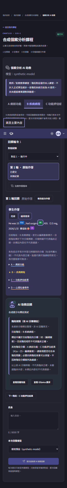
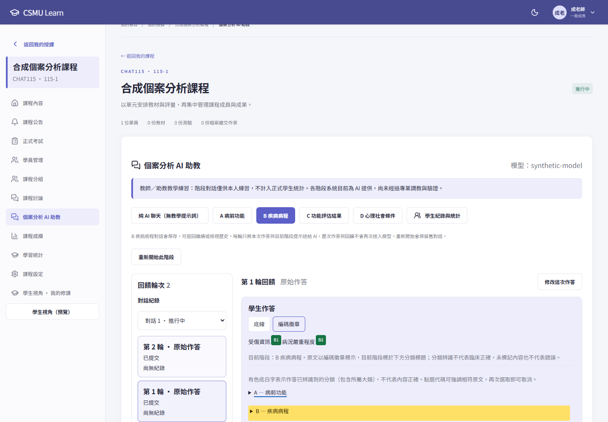
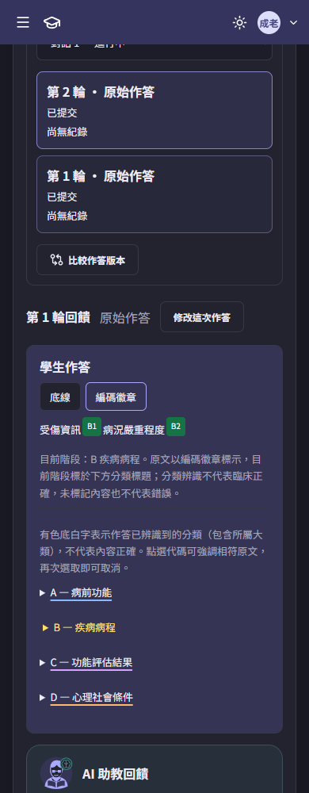

## 2026-11-24 分類頁籤字母徽章（現行）

所有可見phase tab的A–D字母採分類色白字徽章，中文不填色。原藍點改為目前作答階段徽章細外圈／title，沿原完整aria-label；瀏覽tab選取仍用底線，跨階段瀏覽不改目前作答階段。沒有辨識分類的phase仍不生成tab。49Vue、6Chrome淺深／桌面／手機及Vite通過，不改AI分類或Prompt。

## 2026-11-24 緊湊分類標註工具（現行）

ABCD分類區改稱「作答分類標註」，文案精簡；主分類按鈕以內容寬度flex wrap排列，長標籤可換行、最小44px高，不再固定1／2／3等寬欄。保留分類／臨床正確性區別、未標註非錯誤、色彩與✓、混合狀態、複選／hover／原文及說明互動。只有主按鈕布局改動，說明dialog維持responsive多欄。174相關Vue、8Chrome、Vite及diff check通過，不改AI、Prompt或歷史內容。

## 2026-11-24 主題與ABCD配色（現行）

使用者授權重新配置分類色並移除Teams風格。色彩集中ClientApp/src/theme.css：A藍#1d4ed8、B琥珀#9a5b05、C紫#7c3aed、D玫紅#be185d。徽章與已選分類保持深色底白字，深色模式外框／底線用各自亮色。主操作改青綠、目前階段仍藍點；分類定義參考標題沿相同分類色。此節取代較早綠色B／橙色D及紫色操作的現行視覺，原決策留作歷史。

提及為外框、選取為實心與✓、混合為虛線、未提及僅文字、局部hover底線及click圖例保持。ABCD工具仍在徽章tab內，不會因重配色改分類、模型Prompt或DB快照。154相關Vue與23Chrome（含原文／分類／四phase色、淺深／手機／桌面及代表性對比量測）通過，無後端變更。

## 2026-11-23 分類維護只編輯一項（現行）

modal預設ABCD分區精簡清單（代碼／名稱／停用／編輯），點一項後只顯該項欄位；成功「儲存此分類」回清單並聚焦原列。取消返回／關閉不會保存當前草稿，也不會在下一項儲存時夾帶；新增同樣一次一項。沿原完整規則版本API和expectedVersion保護，並不新增逐碼API或變更模型Prompt流程。

## 2026-11-23 教師分類說明維護彈窗（當時設計）

頁面只留「編輯分類說明」入口，原課內分類規則清單移入native modal。全部ABCD欄位與新版本儲存沿用；長內容捲動、標題／footer固定。取消／X／Esc回復最後載入或成功保存的版本並將焦點返回入口；儲存期間暫禁關閉。教師權限與學生POV隔離保持，學生閱讀分類定義及徽章工具不受影響；新規則僅供下一輪分析、既有標註與正式快照不改。

## 2026-11-23 ABCD工具僅在徽章頁籤（現行）

ABCD分類區屬於「編碼徽章」頁籤內的文章下方工具，僅badgeMode且有有效標註可見；原文頁籤保持文章與copy，不顯分類或空工具。原文／徽章原shared mode／snapshot來源不變，分類勾選、run hover／dialog、未提及定義均保留。切原文清選取並關提示，hide-all回原文且移焦原文tab，避免鍵盤焦點留在收合區。

用v-show保持分類DOM與先前瀏覽階段，不由模式控制重新計算標註；兼容legacy外置legendTarget，其實際工具也同步隱藏。沒有DB／模型／Prompt／語意分類變化；撰寫區參考工具不受此tab影響。下方早期文章下方位置仍保留，但常駐plain工具的舊描述由本節取代。

## 2026-11-20 分類工具放文章下方（當時設計）

ABCD分類工具在學生作答原文之後、AI回饋之前，跟隨所選版本，版本歷程保持側欄。移除CaseAnalysisChat前置categoryHost，直接使用PhaseAnnotatedAnswer內聯分類區；空標註提示同樣在原文下。原文／徽章、多選、局部hover、分類定義與未提及分階段不變；桌面／手機按原container寬度分欄。後端標註容量128與長文固定分句傳輸詳Ollama與評估紀錄；DB與UI仍接舊annotations陣列，不以顏色或位置推論臨床正確性。

## 2026-11-20 原文固定純文字／分類選取自動切徽章（現行）

「原文」顯示完整純文字，不畫底線、不顯示徽章、不產生原文互動片段。點選任一已提及分類／全類或「顯示全部標註」後，自動切到「編碼徽章」，在有代碼標示的原文中畫出所選分類底線。徽章仍可 hover／focus 只預覽該 run，點選查看引用與說明；原文片段本身不再提供沒有代碼的 tooltip／點擊入口。

顯式切回原文時清掉分類選取；「隱藏全部標註」同樣清選取並回原文。取消最後一個分類或「取消全部選取」則保留徽章，只取消持續底線。內部 underline 值保留相容，並由渲染 guard 保證 plain 不畫線；父層 shared displayMode／正式快照與歷史來源保持，phase／code 多選、跨階段辨識、連續徽章合併與copy原文不變。只有呈現互動變更，無 DB／API／模型／Prompt修改。

## 2026-11-20 撰寫參考只顯示標題、滑入看定義（現行）

依使用者澄清，CaseCategoryReference 移除常駐完整定義卡片，改為可換行的「代碼 — 標題」小按鈕；ABCD 階段展開與目前階段預設保持。滑鼠移入／鍵盤聚焦才顯示定義 tooltip，滑出延遲關閉；點選或 Enter／Space 可將焦點移入說明以捲動長內容，Escape 關閉後返回原標題且不重開，外部指標／焦點與離開作答也會關閉。

Tooltip 以 Teleport 到 body 避免容器裁切，依視窗定位、必要時可內捲；僅提示框保留長文的必要捲動，標題列自然換行。Parent visible prop 防止作答切回饋時彈出內容殘留；stage／規則變更及 unmount 清除提示與監聽器。沿原 categoryDefinitions 與課內說明，仍只供閱讀，不改草稿／AI 提示／DB。

## 2026-11-20 作答區下方的分類定義參考（現行）

A／B／C／D 作答的 composer 下方提供「分類定義參考」。各階段使用原生可展開區塊，預設展開目前作答階段（該階段沒有啟用分類時開第一個可用階段），可同時展開其他階段。每項顯示代碼、名稱與完整短定義；寬處三欄／中寬兩欄／手機單欄，以頁面正常捲動、不新增內層捲軸。

沿課程當前啟用分類及 categoryDefinitions 共用說明，課內 description 優先，原碼原名稱才套既有閱讀定義；自訂或更名而缺說明時如實顯示未提供，不將舊定義誤套新碼。內容以 Vue 文字輸出，不信任 HTML。只供閱讀，不推算提及、不修改原稿／選碼／送出內容、不發 AI 或其他查閱請求。作答／回饋切換保留草稿，回饋與 Raw 不顯示此參考；唯讀無 composer 時也不顯示。

## 2026-11-20 未提及分類依目前階段分區（現行）

分類工具底部改為「本階段未提及」及「其他階段未提及」。以作答實際 stage 判斷本階段，不隨瀏覽其他分類頁籤改變。每個 ABCD 階段各用獨立行，顯示階段代碼／名稱，行內仍以頓號分隔代碼與名稱；本階段沒有未提及時顯示「無」，沒有未提及的其他階段省略。全部均已提及時沿原行為隱藏整區；未知 stage 則以「未提及」標題逐階段排列，不猜測目前階段。

所有未提及項目保留 hover／focus／點選定義，僅供閱讀、不畫原文底線。分類依據、標註、Prompt、API與DB均不變。

## 2026-11-20 已提及分類：未選外框／選取填色（現行）

已辨識分類及全類按鈕預設透明底、ABCD分類色外框與文字；選取畫底線後才填分類色、白字與勾選。取消後回外框；部分選取的大類以虛線外框表示，不填色。深色主題外框／文字沿既有亮分類色，選取填色沿既有白字對比色。顯示／隱藏全部、取消選取與copy等操作保持平台紫色；未提及文字列、徽章、hover定義與底線互動不變。

## 2026-11-20 分類階段頁籤與作答版本移除（現行）

分類工具由多段可收合標題改為水平頁籤，只列有已辨識分類的階段；藍點標示實際作答階段，不隨瀏覽其他分類頁籤移動。優先開啟目前階段，若未提及則開第一個可用階段。切換保留跨階段已選分類與底線，手機頁籤可水平捲動，支援左右／Home／End及獨立ARIA。未提及分類仍可閱讀定義。

每張未正式提交的本人作答版本右上角新增 ×；確認後沿既有垃圾桶流程移除作答及配對回饋，可還原、原始編號與統計不變。移除其他卡片不改目前選版或未送草稿；pending／忙碌時停用，唯讀／學生POV不提供。學生需先成功載入正式版本資料才提供移除。

任何已正式提交來源（包括已退回及歷史正式版本）都不提供 × 或移至垃圾桶。後端直接呼叫亦回409；與正式提交共用既有stage交易鎖，防止兩操作同時成功。既有已在垃圾桶的正式來源仍可還原。無Migration或資料重寫，不改模型、Prompt、分類輸出或成績。

## 2026-11-20 圖例重複說明合併

同一badge-run的圖例依完整碼集合（排序比較）、status與原explanation精確分組，避免三段C5、相同評語與警示重複占三張卡。每張卡保留各段quote；同一start／end／text的重複occurrence只顯示一次，位置不同仍保留。分類／狀態／評語不同則分卡，避免錯配臨床警示與來源。沒有改annotations、badge-run、原文或API／DB；只以legendEntries computed呈現，定位寬度亦用合併後卡數，三段相同C5為一張352px（窄視窗依邊界縮小）。

## 2026-11-20 分類操作採平台紫色（現行）

依後續指示，分類、show／hide、取消選取及copy的操作底色改為平台既有#5b5fc7紫色白字，hover #4a4eb3；取代下節的primary藍。保留已選分類色＋✓、mixed虛線與原文／徽章色，不更改目前階段標題。

## 2026-11-20 分類操作按鈕 primary 對比

分類按鈕、顯示／隱藏全部、取消選取及複製到輸入框改#0d6efd藍底白字，hover深藍，淺／深主題一致。已選分類沿ABCD色並以✓標記，部分選取用白虛線，不只靠背景色區分狀態。原文徽章與未提及文字的分類色／定義保持。只調整此元件，不引入Bootstrap套件或改全站theme；相關Vue42／Chrome9及build通過。

## 2026-11-20 分類控制精簡與定義 tooltip

已辨識的分類及父碼維持可多選按鈕，未提及分類不再占用停用方塊，集中在下方「未提及：A1f 利手、…」文字列，階段若沒有可選代碼亦不顯示空按鈕區。文字項目可查閱定義但不能畫線，並不因可滑入／聚焦就成為已辨識分類；全部提及時不顯示空列。

分類按鈕及未提及文字均有滑入／focus 定義提示，手機可點文字；例如「利手」提示「慣用手（handedness）」。優先使用所選回合分類快照的 description；缺省閱讀提示整理自 [既有教授編碼規格](01-professor-rubric.md)，只在代碼與原名稱一致時使用，改名／新碼沒有說明則明示未提供。不新增臨床推論、不改分類引擎、DB／Prompt／規則版本。提示內容以安全文字輸出，可 Escape／外部關閉、隨 viewport 重新定位，支援長內容內捲與聚焦後保留；切輪／模式清理。此節取代較早「未辨識灰色停用按鈕」的現行效力。

## 2026-11-20 標籤滑入提示與點開圖例

滑入／鍵盤聚焦原文徽章時保留該片段的暫時底線，只顯示短提示「點選開啟分類圖例」；詳細AI說明不在hover時自動展開。點選標籤或已選取底線片段後，才開啟非模態分類圖例，保留原始引用、分類名稱、AI說明及unverified／unsupported／misplaced教學限制。Tooltip不放按鈕，不導覽到其他分類區，也不新增後端請求。

詳細圖例條目依可用視窗顯示最多三欄／中寬兩欄／手機一欄，少量條目不留空欄。主分類按鈕原有全寬直排也改容器式響應欄位：可用寬度至少520px兩欄，桌機視窗至少1200px且容器至少760px三欄，窄處一欄。保留分類多選、全部顯隱與連續徽章合併；開圖例不改篩選、不更改原作答。

關閉／Escape返回觸發標籤；點選或聚焦其他控制項則關閉且保留目的地焦點，不搶走其他對話框Escape。視窗縮放及外頁捲動重新定位，圖例保持視窗內、內部可捲。切換作答／模式會清掉舊圖例。這是前端互動調整，不改模型、Prompt、授權、API或資料庫。

2026-11-20 頁籤再精簡：原「無／底線」合為「原文」，預設仍無線、點分類才畫線。保留編碼徽章，旁加非互動／aria-hidden的A1藍底白字示例；真實徽章與hover／多選行為不變。此節取代較早三mode介面描述。

2026-11-20 現行標註：預設無底線／文字底色，多選phase或code才畫相符分類線，其他完全隱藏。徽章外觀與run合併保留；hover／focus局部原文暫時畫線，離開恢復多選狀態，點徽章提示不清篩選。教師課內規則版本及舊回合snapshot分離；這是分類輔助，非臨床評分。詳[11/19修正](../case-analysis-2026-11-19-corrections.md)。

# 四階段原文分類標註

## 2026-11-19 連續徽章 run

相同完整code set的連續片段在badge模式只顯示一個run末端徽章，code順序可不同；標點／空白可銜接，不同code set或未標註prose中止。C1×3縮為一個，C1／C2／C1保持三個。原segments與AI結果不改，不把未標註prose當已分類。

合併tooltip保留所有原說明與status（原annotation物件去重），並標示片段合併；underline／none、選碼及copy維持原字串與範圍。Vue340、Chrome43與Vite通過，手機深色已檢視，7173靜態更新，無DB／模型／Prompt或服務重啟。

## 2026-11-19 無／底線／編碼徽章

新增最左「無」頁籤（預設仍底線）。none直接顯示完整原文，不產生annotation互動span／badge／線／框／tooltip；左分類與選碼維持，切回既有模式才套用強調。none用「已選取／取消選取」及「原文標註已隱藏」文案，三tab aria／keyboard與跨輪mode共用保持，不持久化UI模式。

Vue337／相關90、Chrome41與Vite成功，手機深色已檢視；7173靜態更新，無重啟／模型／DB變更。

## 2026-11-19 ABCD 與 revision history 共用左欄

分類圖例移至既有工作區左欄上方，對話／回饋歷程及版本比較在下方。原作答與AI回饋留右欄，底線／徽章tabs及copy仍在作答卡片；分類選碼及原文強調維持同一controller。選用DOM ref＋Vue Teleport只移legend／selected-status，無target獨立使用仍inline；原palette隨wrapper保留。

桌面rail240–280px、sticky並有viewport內scroll；<=1050px分類及歷程堆疊於作答前，不壓縮文字欄。空標註有提示，切輪／session分類隨原作答更新，Raw不加入此欄，teacher review仍readonly。Vue335、Chrome41及Vite通過；無DB／模型／Prompt變更，唯一7173靜態更新。

## 2026-11-19 未辨識圖例停用

未辨識圖例代碼顯示灰色停用外觀（opacity .55、not-allowed游標）與native disabled，不可點選／不進Tab停駐，標籤仍可閱讀。已辨識父碼含子碼維持可用；外框／選取填色、原文徽章與選取強調保持。Vue相關84、Chrome相關10及Vite通過，僅7173靜態更新。

## 2026-11-19 圖例按鈕：辨識外框、選取色底

分類圖例三態：未辨識→中性；辨識但未選→phase色外框及中性底；辨識且選取→category色底白字。父碼仍含子碼；深色外框採較亮phase色，選取填色不變。未標註B時整組按鈕不帶辨識色。原文實心badge及先前兩種選取強調不變。

legend文案同步，Vue相關83、Vite與Chrome40情境（38＋2選取過渡復驗）通過，手機深色已檢視；只有7173靜態更新、無重啟／DB／模型改動。

## 2026-11-19 分類點選強調依顯示模式

底線模式點選分類：相符原文使用實線outline，既有各色底線保留。編碼徽章模式點選分類：所有徽章保留、不畫outline，僅相符原文增加所選分類phase色底線；同phase不同code不加線，混合phase片段只顯所選色。父碼仍可匹配子碼；再按同碼／顯示全部取消。切換模式保留選碼並轉換呈現，切作答仍清除。只改UI、不改AI輸出或資料。

Vue334、Chrome40（桌面淺／手機深及既有流程）及Vite通過；7173已靜態更新，無重啟。

## 2026-11-19 標註頁籤／primary 目前階段

底線與編碼徽章現在使用可存取頁籤：唯一ID、選取狀態及同tabpanel關聯，左右／Home／End鍵即時啟用並移焦點；切輪保留選擇。複製到輸入框在頁籤外仍是一般button，不自動提交。無有效標註不提供空模式頁籤。

目前階段分類標題在兩theme皆#0d6efd底白字，取代舊黃底／深色黃字；其他ABCD分類色及原文不變，不載入Bootstrap套件。Vue333、Chrome38及Vite通過，手機深色已檢視，7173靜態更新，無服務重啟／Raw清除。

## 2026-11-19 分句名額修正

Omni compact schema原限8筆，在細分逗號後會很早耗盡，即使input／output仍未達context。現在compact與standard皆允許48 annotation片段，server維持48上限；compact每片段text160／explanation80、feedback600及每段8codes保持。Omni正式輸出5120tokens、Raw512／context16384保持，其他profile不改。模型可能漏標，48是上限不是必須填滿或全篇完成保證。

正式A/C/D20261119-v6、B20261119-b-v8，新提交才使用，不猜補舊回覆。合成48分句live test回48有效片段、最末589／590、input2743／output3253／stop；只驗容量，不判語意正確。最終443後端及VS含Vue通過，已部署7173。

## 2026-11-19 分句引用而非整句綁碼

徽章原本即顯示於每個有效quote末端，並不等待中文句號。這次修正產生quote的粒度：正式輸出提示要求同句不同事實分開；可用中文／英文逗號、頓號、分號、冒號、句尾符號及換行。分句候選保留小數／日期／時間／千分位／常見縮寫／括號／引號／短欄位label:value，不把標點當臨床分類規則。

有界條件下以schema text.enum限原文分句，模型選codes，UI不猜整段代碼屬哪個詞。僅>=2不同候選、<=128分句且各quote符合既有長度時啟用，否則保留自由引用。原文、UTF16／occurrence、多碼、色彩及tooltip保持，已存舊標註不動；新提交採20261119 A/C/D v4、B v6。示例（合成）：He was 15 [A1a], had surgery [B5], ADL… [C5]。模型仍可錯碼或漏標，不等於臨床驗收。

Vue331、後端隔離433、Chrome相關8、VS含Vue通過；以下為合成逐分句畫面：

## 2026-11-17 徽章沿ABCD分類色（現行）

取代下方較早全部綠底的設計：行內code依所屬phase顯示A藍／B綠／C紫／D橘底＋白字，沿既有分類palette。同片段跨phase多碼各自著色，仍保留共同tooltip操作。淺色與phase底線相同色值，深色保留同色系深底以維持白字對比，底線沿原亮色。原文、metadata及上下文均不改。

既有Vue回歸擴充後49/49，Chrome桌面／手機淺深色6/6、Vite通過，包含四種computed色值、白字、跨phase多碼與原文不變；已檢視390深色合成截圖。前端部署不重啟7173，無DB／模型變更。

## 2026-11-17 底線／編碼徽章可切換（現行）

有效分類原文上方新增兩種顯示模式，預設「底線」，本頁切換輪次／版本保持選擇，刷新重設，不入storage或DB。

- 底線：依分類色顯示，多phase疊線；不同code集合相鄰時交界各縮3px，讓同色B1／B2之間有6px空隙。相同集合保持連續，不依標點切割，不改文字與offset。
- 編碼徽章：原文不畫底線，在有效顯示片段末端插入綠底白字code註記，多碼共用徽章。hover／鍵盤focus／touch可查看原分類tooltip，Escape或切換模式關閉。徽章是顯示元素，不回寫原文或送入模型。

已辨識分類圖例、目前階段標題及選取細外框維持；階段核對依模式改稱底線或徽章。課內學生／教師查閱與既有Studio共用。Vue280、Chrome26與Vite通過，含桌面／手機淺深色、原文安全渲染與配對歷程回歸。以下畫面皆為合成資料：

## 2026-11-17 原文統一分類色底線（現行）

依使用者確認，移除原文的淺色黃底與深色黃字，所有phase均使用分類色底線（包括目前階段），多phase同段保留疊線。文字繼承一般字色、背景透明；目前階段強調僅留於分類標題。辨識碼按鈕色底白字、點選細外框與tooltip維持。階段核對及提示文案不再稱原文背景標示。本項取代下方原文黃色顯示規則，歷史保留。相關Vue56、桌面／手機淺深色Chrome8與Vite通過。

## 2026-11-17 深色模式黃字（現行）

目前階段相符原文及phase分類標題，在深色模式改#ffe066黃字與透明背景；淺色維持黃底深字。本項取代先前「淺深模式皆黃底」規則。混合分類仍有其他phase底線，深色回用原亮色；已辨識碼按鈕仍分類深底白字。篩選強調、tooltip及正確性限制不變。相關Vue12、桌面／手機淺深色Chrome8與Vite通過。

## 2026-11-17 移除重複總列

分類區直接顯示A／B／C／D四個獨立可展開分類，移除頂部「分類圖例」重複階段總列及外層details。提示文字、已辨識色底白字、目前階段黃色與代碼強調功能維持；不改標註或模型行為。相關Vue12、Chrome22與Vite通過，桌面／手機淺深色合成截圖已更新。

## 2026-11-17 圖例中已辨識的類別

作答有效標註內的分類按鈕使用A藍／B綠／C紫／D橘深色底＋白字，未辨識者保留中性。子碼也標示其存在的父類（例如A2a同時標A2）；父碼不推論未標記細項，點選父類可強調該類的已標註子碼。aria-label說明作答已辨識，aria-pressed仍只代表使用者的篩選選取。已辨識不代表臨床正確；原文黃底與跨phase底線不變。相關Vue12、Chrome淺深色／桌面手機4及Vite通過。

## 2026-11-16 相符標記統一黃色（最新）

使用者反映低透明度phase色與容器衝突，目前階段相符內容及圖例改為不透明黃色#ffe066、深色字#332a00，淺深模式一致；篩選淡化用#e6dca7仍保留字色對比。其他phase底線保留，多碼重疊可在黃底畫線；黃底內使用較深版phase色以免深色主題淺色底線消失。黃色只代表目前階段分類相符，不是臨床正確。相關Vue10、Chrome4、Vite及手機深色視覺核對通過；沒有後端或DB改動。

## 2026-11-16 目前階段相符與其他階段（現行）

依使用者新要求，明確傳入伺服器選定／已儲存作答的stage：例如目前B疾病病程，辨識為B的原文用黃色背景，辨識為A／C／D的原文仍用該階段彩色底線；同片段有合理多碼時背景與底線並存。圖例標出目前階段，tooltip保留每碼、分類位置與unverified／unsupported／misplaced的證據限制。沒有有效stage的舊呼叫維持細底線，Raw仍不使用此元件。

CaseChat及Studio回饋區新增「階段核對（依AI分類標註）」；明示系統依標註整理、不是AI原回覆。只使用通過exact-text驗證的該版標註，列出目前階段及其他分類，提示核對是否放錯位置；未標記不代表缺漏，必要跨階段背景可以保留，不強迫補資料、不自動扣分。舊AI文字與DB metadata不改寫，沒有新Migration。

此規則取代最初「所有分類一律只有底線」的顯示。背景代表與目前階段的**分類相符**，不是答案／診斷正確，不能作成績依據。新回歸包含B內A、B內B、合法A/B同範圍、多版本／教師、未標記本階段內容及淺深色／手機。

## 架構與歷程

課內 CaseAnalysisChat 維持四階段／每輪 user 與 assistant 配對。新增的內部模型 envelope 包含 `feedback` 與 `annotations`，公開 `content` 仍是回饋文字，新增選用 `annotations`。039只增加 nullable JSONB metadata及原不可變 trigger 的保護欄位；同一交易保存 assistant 的回饋、效能及標註，`in_reply_to` 固定對應送出原文。不重算歷史標註，不改舊答案或成績。

既有案例學習 Studio 沿用 summary／supportedPoints／improvements／nextSteps 及既有 JSON 欄位儲存，追加選用 annotations；用 answerVersionId、儲存的 answer.Text 驗證，無額外Studio migration。既有案例版本的 Material 作為獨立 caseFacts，不與學生原文混用。Raw Chat 不產生標註、無新 schema／DB／統計。

`CaseCodingCatalog` 為唯一43碼目錄，由已授權的配置／StudioCase DTO提供前端。沒有 A2c、B2c、C5子碼、A4未核定子碼或第五分析階段。

## 格式與驗證

保存後每筆：`annotationId, start, end, text, codes[], explanation, status`。ID由伺服器產生，phase由代碼目錄推導，允許同範圍跨phase多碼。start為0起算UTF-16 code unit，end exclusive；與.NET字串／JavaScript slice一致。

實際模型無法可靠計算索引，因此AI專用schema使用`text, occurrence, codes, explanation, status`：text逐字引用解碼後answerText，occurrence明確指定該片語0起算出現次序（重疊亦計次）。伺服器以Ordinal完全相同搜尋取得UTF-16範圍；不是先接收錯誤offset再猜位置修補。明確指定不存在的出現次序、改寫文字或同筆混用occurrence與start/end均拒絕。後端仍能驗證舊numeric表示，公開輸出及前端只收標準範圍，沒有破壞舊歷程。最新user僅在Stage Provider內包成answerText及格式提醒，原始DB內容與Raw封包不變。

後端CaseAnnotationContract及前端caseAnnotations均驗證整數範圍、完整代理對邊界、原文substring完全相同、已核定代碼。不用trim／正規化、不搜尋替代位置，不因重複片語而改標另一處。錯誤標註丟棄而保留有效文字回饋；壞envelope則保留原作答供重試，不保存假成功。最多48筆、每筆8碼及200 UTF-16單元說明。原文不經v-html／AI HTML；tooltip及legend均使用Vue文字插值。

前端把有效範圍的所有邊界切成union片段，每個原文字元只出現一次，同片段匯集覆蓋碼及status。未提交編輯器不插markup，僅在已有配對AI回饋的唯讀原文呈現。切換版本／學生／階段會清掉當前tooltip與legend選擇；教師讀回同一原文。

## 教學界線

底線代表分類辨識，不代表答對，也不自動計分；未標註不表示錯誤。`unverified`為預設未核實，`unsupported`保留臨床依據不足／衝突，`misplaced`提示可能階段錯置。tooltip保留原回饋疑點，不將有色底線誤稱為臨床驗證。沒有參考案例時不推測遺漏；不揭露參考答案。

## 色彩與操作

| 階段 | 淺色／深色底線 | 說明 |
| --- | --- | --- |
| A | #1861b8／#86bbff | 病前功能 |
| B | #167343／#78d7a3 | 疾病病程 |
| C | #853ac3／#d4a2ff | 功能評估結果 |
| D | #a74e0b／#ffb66d | 心理社會條件 |

目前階段用淡色背景，其他phase採細線，多phase重疊可同時背景與多條底線；缺stage時維持原細線模式。focus outline及文字碼名提供非色彩辨識。Tooltip支援hover、focus、Enter／Space、觸控點選、Escape及外側關閉，位置限制於視窗並隨捲動重算。圖例採原生details展開四階段及細碼，選碼強調相符標註、再次選取或顯示全部取消。

## 畫面與測試

以下為合成API瀏覽器fixture，**不是模型品質成果或真實學生資料**。

2026-11-16新截圖已更新為階段核對版：桌面為B淡色背景並保留A底線，手機為B中A內容的保守核對提示，第三張展示合法A/B同段。不把合成截圖當模型效果證明。最新Vue265、Chrome17及後端DB362通過；模型小樣本仍有語義失敗，見03最新增量。

Vue256項、Chrome13流程通過；含多碼、重疊、中文／英文、emoji、重複片語、空集合、失效offset、XSS文字、修訂／session、教師唯讀、四phase、1440／390px及淺深色。底線與作答表面實測對比至少4.85:1。尚未做螢幕閱讀器人工驗收；模型可能少標、錯分、錯估索引，錯誤範圍驗證只能防誤畫，不能保證臨床分類品質。詳見[測試報告](03-evaluation-results.md)與[人員待確認](04-open-questions.md)。
