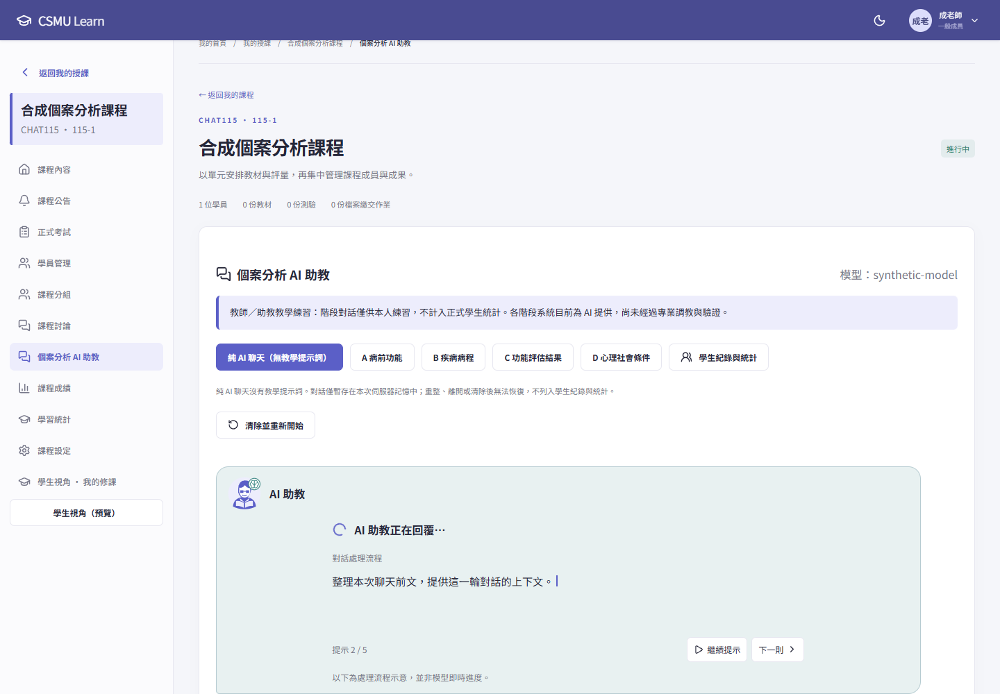

# AI 助教回饋輪次、版本比較與效能

## 2026-11-17 等待區改為處理流程示意

Stage等待標題改「AI 助教處理中…」，逐字輪播接收作答、閱讀內容、分類、整理逐字標註、準備底線／編碼徽章著色資料及彙整回饋。Raw則為訊息送出、聊天前文與等待回應，不顯示分類活動。caption明示非模型即時進度，接收不代表DB成功；實際回覆及著色仍須等完整回傳驗證，不偽造進度或partial output。暫停／下一則、減少動態及timer清理維持。相關Vue46、Chrome2及Vite通過，以下原有合成等待截圖已更新。

## 2026-11-17 等待時逐字顯示請求重點

等待回覆的泡泡現以逐字文字、游標輪播公開的要求摘要，含目前phase、分類與原文引用、證據限制、回饋方向及該phase分類碼。這是對照既有Prompt維護的前端教學摘要，不是模型生成中的內容、內部推理、執行順序或進度；原實際payload檢視功能不變。Raw使用獨立無教學提示詞／上下文暫存說明。

提示可暫停／續播與手動下一則；系統偏好減少動態時顯示完整靜態文字、停止自動輪播。真正回覆到達、錯誤、切模式或離開後清除動畫及timer。所有文字僅存在UI，不加入messages、作答或後續LLM request，不讀取敏感案例或私有Prompt。Vue285、Chrome26及Vite通過；以下為延遲合成API畫面：

## 2026-11-17 作答分類顯示模式

有效分類作答可切換「底線／編碼徽章」，預設底線，本頁切輪次保留選擇。底線在相鄰不同code交界留間隙；徽章為片段末端A藍／B綠／C紫／D橘底白字code，同片段跨phase各碼分別著色，可開啟分類說明。深色沿同色系深底維持白字對比。只改顯示，不改原文、分類、版本比較或模型payload；刷新恢復預設。詳[標註UI](ai-tuning/06-annotation-ui.md)。

## 2026-11-17 輪次最新在上

回饋輪次sidebar從新到舊排列，保留原編號，例如第3輪、第2輪、第1輪；預設仍選最新。原資料時間序、版本比較、修改來源、回饋與效能配對不變；教師查閱也採相同順序。

## 2026-11-17 等待回覆泡泡

送出或重試等待Ollama期間，Raw及四階段回覆區以既有assistant泡泡、教授圖示及轉圈顯示「AI 助教正在回覆…」。僅為頁面狀態，不新增聊天紀錄；成功／失敗／模式切換後移除。等待中不顯示空白「尚無訊息」，role=status提供文字提示；減少動態偏好時保留靜態圖示與文字。

## 2026-11-17 每輪獨立評閱

四階段歷史仍完整保存DB供輪次、diff及教師查閱，但每次模型請求僅送目前階段提示與本次作答，不再送歷次草稿／AI回饋。Raw保留多輪記憶。教師／TA本人新回覆旁可直接點「查看 Ollama 請求」開對應實際payload；舊回覆或刷新後不可重建。詳[請求操作](ollama/request-dialog.md)。

## 2026-11-17 實際 Ollama 請求分頁

效能dialog新增統計／Ollama請求分頁，僅供本課教師／TA檢視本人本頁新回覆。依真正送出的payload顯示訊息／schema／模型參數並複製JSON；綁定原replyTo／Raw session及輪次，不以目前設定回推歷史。擷取僅HTTP／頁面記憶體，學生／預覽／教師查學生不提供，切換模式／帳號／清除後釋放。完整行為、權限及測試見[實際請求說明](ollama/request-dialog.md)。既有統計／DB／Raw隱私規則不變，沒有新Migration。

更新：2026-11-16，已同步至唯一7173環境。

## 操作與行為

四階段介面採左側「回饋輪次」、右側「該次作答＋對應AI回饋」。仍可選工作階段；教師查閱維持唯讀、按學生／階段隔離。待回覆或失敗的提問也列入輪次，失敗沿原訊息重試。

學生可點「修改這次作答」載入選中原文，再按「提交並取得 AI 助教回饋」產生新輪次。原文與AI回覆不覆寫，系統保存明確修訂來源與修改次數；一般新提問不自動視為前一題修改。重試同一失敗回覆不算另一次修改。回饋後可手動按「下一階段」，沒有新增AI過關／自動跳階／成績。

切換輪次不重寫草稿；載入別版、切換對話／階段／教師查閱或離頁前會確認尚未提交內容。取消後保留草稿、修訂來源與原選擇。

## 效能彈出對話框

每筆assistant旁提供「查看回覆效能」，Raw及四階段均可用。彈窗顯示該筆模型／提示版本、輸入／快取／輸出Token、生成tok/s、模型處理／載入／輸入處理／生成耗時，及應用程式與模型服務間往返時間。ns換秒除1e9，ms換秒除1000；往返時間不是完整瀏覽器、授權或DB流程耗時。

舊回覆未保存的效能維持NULL並明示未提供，不回填或拿最新數字替代。新provider回覆逐項記錄availableFields；模型缺少欄位與真實量測0分開顯示（例如部分Ollama版本沒有快取Token欄位）。只保存數值、已知欄位名與白名單結束原因，不保存prompt／raw response／thinking或錯誤本文。

四階段效能與assistant一起持久化且不可改寫；Raw只在原暫存context保留效能，清除／過期一併釋放，不寫DB、不送回模型上下文，也不列正式學生統計。原Raw隔離、20m逾時與明確帳號清除保留。

## 任兩版學生原文比較

使用者已明確確認比對學生作答／提問。按「比較作答版本」，可從目前同一學生、課程及階段已授權的工作階段歷史任選兩版，也可反向比較。完整保留文字、空白、換行與Unicode code points；紅色刪除、綠色新增，無變更則明示相同。內容以Vue純文字輸出，不執行HTML。

演算法先修剪相同前後綴，再做有250,000 cell硬上限的LCS；超過預算明示改用整段刪增，完整內容仍可重建，不宣稱最小差異。比對不呼叫LLM、不建立成績，也不另外傳送／保存學生文字至外部服務。

## 資料庫／API

Migration **038_case_chat_feedback_rounds.sql**新增nullable performance_metrics與revises_message_id，舊資料保留NULL。revision parent只允許同課、同本人、同stage、同practice的已完成user作答；DB trigger與workflow雙重檢查，禁止把他人／AI回覆／未完成提問當來源。原始content、版本來源與效能metadata不可覆寫。

CaseChatInput新增可選revisesMessageId，冪等requestId也會核對來源，避免同ID換parent。CaseChatMessage增加metrics／revisesMessageId，CaseChatStatistics增加revisionCount；修改次數由明確parent重算，並非總提問數。RawMessage增加只在記憶體的metrics。既有沒有提供新欄位的呼叫仍相容。

## 驗證與部署

- Vue：60檔 **241/241**；Chrome **15/15**（8個聊天情境＋7個既有師生／評分流程），含1440／390、原生dialog、任兩版比對、round1/3選取、舊輪次修訂、新UUID／parent、同ID失敗重試、鍵盤與取消草稿、Raw重整／BFcache。
- .NET一般 **283通過／47條件式DB略過**；另以授權隔離schema啟用DB後完整 **330/330，0略過**。覆蓋來源授權、修改／往返計數、原文／metadata不可改寫、逐筆效能、缺值／0、Raw效能不入模型及原有功能。
- 036→037→038真實舊資料fixture含原文／回饋、名冊與已發布成績，升級及重跑指紋一致；舊metric／parent為NULL。完成即刪測試schema。
- 同一真實Ollama provider合成2Raw＋1Stage傳輸成功，Raw逐筆效能可用欄位確認；沒有DB聊天種子或內容輸出。三profile設定／outbound payload及System Prompt不改，本次只補回覆量測欄位存在性。
- Public038已交易套用；標準VS MSBuild含Vite通過。正常bin/Debug PID26108只綁7173，/courses200及index-s9KPMSBt.js確認；其他既有舊埠無listener，後續仍須重查。
- Code review修正未提交草稿被覆寫問題，並補模型缺省數值不應視為量測0；先重現失敗後回歸通過。未執行完整歷史E2E或模型教學品質評估；無獨立TypeScript檢查設定，Vue經Vite編譯。

## 主要檔案

`CaseAnalysisChat.vue`與對應測試／E2E、`ChatPerformanceDialog.vue`、`AnswerRevisionDiff.vue`、`utils/answerDiff.js`；Models/CaseAnalysisChatModels、RawChatModels、ChatModels；Services/CaseAnalysisChat兩部分、RawChatSessions、ChatPerformanceMetrics、OllamaClient；Database038與PortalSmoke升級／合成測試工具。既有未提交功能與文件均保留，未提交／推送Git。
