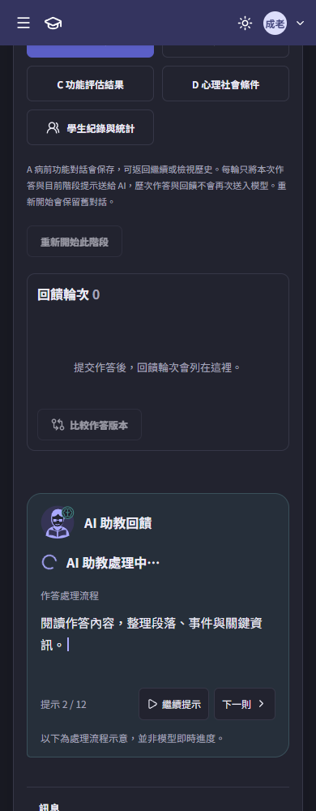

## 2026-11-24 下方教授卡的回覆失敗狀態（現行）

composer送出／重試錯誤顯示於同一等待／完成卡的failed狀態：停止輪播及spinner，保留作答，提供就地重試。教師／授權TA依原權限看當次安全診斷及失敗請求，學生只見可理解的錯誤；一般載入／管理錯誤仍在頁首。新請求／切模式／切模型／清除重設卡片，當次錯誤與封包不寫聊天歷史。

正式length不發布部分回饋，重試沿同一已存作答，仍受唯讀／忙碌／字數／授權保護，不虛增完成往返。Taipei Omni正式輸出提高至8192，Raw及其他profile保持；增加額度不保證每筆完成，錯誤不可顯示成成功。

## 2026-11-23 按鈕續載每次五份作答（現行）

本人正式階段歷程改為後端分頁：首批5份user/reply pair，點按鈕才fetch下一批並append；不監聽scroll或observer。模型／trash篩選皆server-side首批重載，metadata保留所有本人模型與總筆數，#N在篩選前排名，追加保留選取／草稿。失敗重試同游標、請求去重／取消、比較只取已載入作答。目標完成／失敗／還原用有界target查找，亦最多5pairs；併發新紀錄造成不相接prefix時重設而非跳過缺口。

既有stages/{stage}、messages、retry、trash/restore支援paged=true；GET另可before／model／trashed／target（before與target不得並用）。不帶paged維持完整舊回傳。新增可選pagination及user.historyNumber，不寫DB、不改正式快照／學生統計。Raw沒有新增持久化分頁。角色限制見權限規格。

## 2026-11-23 ABCD分類歸入徽章頁籤（現行）

作答顯示選「原文」時，ABCD工具與空提示收起，僅保留純文章及複製入口；選「編碼徽章」才在同一panel文章下方顯示工具。分類多選／局部hover／定義／未提及不變，切原文清選取與提示，hide-all回原文並移焦tab。適用學生與教師正式快照，撰寫定義參考保持獨立。此輪純呈現修改，不改標註、快照、Prompt或歷史模型篩選。

## 2026-11-23 單份作答／回饋與模型篩選（現行）

每個正式階段使用單層歷程清單：每項是一份本人作答及同一session中replyTo相符的AI回饋，跨舊房間一起按日期排列、由新至舊顯示。原始#N依整階段定義，模型篩選與垃圾桶不重新編號。session仍是DB相容性／診斷定位資料，不以房間選單呈現，不改任何原文、祖先、正式快照或統計。

上方「模型篩選」預設全部模型，依已保存的回覆modelName（作答fallback）列選項，舊退役模型與未記錄模型都可查；同session用過不同模型可分別篩選。它不控制下一次提交的modelProfile、不清草稿、不發新API。沒有符合項目就顯示空清單，不夾帶其他模型回覆。比較視窗仍能跨模型選原稿；完成卡可清篩選揭露剛完成的結果，沿原全域編號與捲動。

正式階段不再提供restart房間；查看closed作答可繼續目前composer、completed可copy並沿既有後端保存跨session修改來源。只有active尾筆失敗可retry；唯讀、本人trash／restore與正式提交保護保持。Raw Chat仍是隔離的多輪聊天。這次僅Vue投影與操作調整，無Migration／API變更。

## 2026-11-20 四階段撰寫指引（現行）

教師／TA正式階段可展開四階段中英說明、面向、撰寫重點與核心問題表，預展當前階段；學生composer內可展開目前階段指引及對照。來源明示依既有架構整理、非教授教材逐項摘錄、尚待核對。Vue與C#共用stage-guidance.json，正式AI與B評語重整納入當前指引，非事實／必填表、不新增分類或覆寫課內規則。A/C/Dv8、Bv10，原稿／舊回饋／正式快照不重寫；Raw無變更，展開不發請求或改草稿。

## 2026-11-20 作答卡操作排列（現行）

複製到輸入框靠右，左側保留原文／編碼徽章模式；手機可換行仍靠右。版本標題不再提供重複的移至垃圾桶按鈕，沿版本卡右上X確認移入；垃圾桶檢視的還原入口、正式提交保護與既有後端授權不變。

## 2026-11-20 輪播卡內的完成入口（現行）

教授等待卡完成後保留在輸入框下方，顯示完成圖示、亮起的carousel指示線與紫色「查看最新回饋／回覆（#N）」連結。完成停止動畫／timer並收起提示控制與示意說明，下一次請求重設暫停後開始。點擊仍使用visitLatestResult選取最新版本、切回饋、history捲頂及結果捲動／聚焦，reduced-motion沿auto。狀態入口不算聊天訊息、不寫歷史或改模型。

## 2026-11-20 原文固定純文字／分類選取自動切徽章（現行）

「原文」顯示完整純文字，不畫底線、不顯示徽章、不產生原文互動片段。點選任一已提及分類／全類或「顯示全部標註」後，自動切到「編碼徽章」，在有代碼標示的原文中畫出所選分類底線。徽章仍可 hover／focus 只預覽該 run，點選查看引用與說明；原文片段本身不再提供沒有代碼的 tooltip／點擊入口。

顯式切回原文時清掉分類選取；「隱藏全部標註」同樣清選取並回原文。取消最後一個分類或「取消全部選取」則保留徽章，只取消持續底線。內部 underline 值保留相容，並由渲染 guard 保證 plain 不畫線；父層 shared displayMode／正式快照與歷史來源保持，phase／code 多選、跨階段辨識、連續徽章合併與copy原文不變。只有呈現互動變更，無 DB／API／模型／Prompt修改。

## 2026-11-20 工作區在上、分析階段在下（現行）

最上層依序為「作答／回饋／AI 對話測試」，作答與回饋下層共用 A 病前功能／B 疾病病程／C 功能評估結果／D 心理社會條件。AI 對話測試時不顯示階段列；沿既有角色限制只提供本課教師／TA測試，學生不因改版取得 Raw 或指定模型權限。教師「正式提交與統計」改為標題旁工具入口，其批閱以相同下層階段頁籤切換，不再重複階段 select。

同階段作答與回饋只改顯示狀態，保留草稿、正式元件、所選作業與回饋；跨階段維持所選上層工作區，沿原離開確認清除未送草稿。離開 Raw 仍確認、清除暫存並隔離上下文；從 Raw 返回時開啟最近的正式階段與明確選取的作答／回饋。初次教師仍沿原測試預設、學生沿原 A 階段／有歷程查看預設。完成連結與複製作答仍分別導向回饋及作答。

兩層各有獨立 tablist／tabpanel／ARIA 關聯；方向鍵與 Home／End 只移焦，Enter／Space 才切換，避免移焦即清除 Raw。手機導覽各自橫向捲動。階段 AI 請求期間上層停用；Raw pending 仍可確認離開並隔離遲到回覆。無 API、資料庫、模型或 Prompt 修改。

使用者追加：AI 對話測試的聊天訊息置於上方，輸入框放在下方；採真實 DOM 閱讀順序（先 log 再 form），保留輸入框下方等待／完成提示。A／B／C／D 作答／回饋仍以原 v-show 分離且保留元件與草稿。既有 Raw 單元先驗失敗再移動 form，桌面／手機 Chrome 增加訊息位於輸入框上方的 bounds 驗證。

## 2026-11-20 分類階段頁籤與作答版本移除（現行）

分類工具由多段可收合標題改為水平頁籤，只列有已辨識分類的階段；藍點標示實際作答階段，不隨瀏覽其他分類頁籤移動。優先開啟目前階段，若未提及則開第一個可用階段。切換保留跨階段已選分類與底線，手機頁籤可水平捲動，支援左右／Home／End及獨立ARIA。未提及分類仍可閱讀定義。

每張未正式提交的本人作答版本右上角新增 ×；確認後沿既有垃圾桶流程移除作答及配對回饋，可還原、原始編號與統計不變。移除其他卡片不改目前選版或未送草稿；pending／忙碌時停用，唯讀／學生POV不提供。學生需先成功載入正式版本資料才提供移除。

任何已正式提交來源（包括已退回及歷史正式版本）都不提供 × 或移至垃圾桶。後端直接呼叫亦回409；與正式提交共用既有stage交易鎖，防止兩操作同時成功。既有已在垃圾桶的正式來源仍可還原。無Migration或資料重寫，不改模型、Prompt、分類輸出或成績。

2026-11-20 現行：四階段以「作答／查看回饋」頁籤分離編輯與閱讀，切換保留草稿。歷史日期選單、正式版本、分類與回饋只在查看顯示；作答則顯示輸入、選模與等待／完成提示。送出成功仍停留作答，點完成連結才選取最新回饋、將選單清單捲頂並保持關閉、聚焦回覆；copy確認後返回作答。AI 與正式版本均以完整作答左右並排比較；本人 trash、正式快照與教師／學生隔離保持。詳[交付](case-analysis-2026-11-19-corrections.md)。

## 2026-11-20 平面作答版本清單（現行）

使用者改採全部版本直接列出，不再使用下拉。RevisionHistoryList取代RevisionHistorySelect：每張按鈕只顯示粗體#N與日期副標題，倒序且維持原順序號碼，trash不重編。刪除「原始／修改N次」顯示層級及重複選取摘要；原始source chain與正式版號不變。所選主標題／latest link／copy來源亦以同一#N表示，原生對話選單與日期diff維持。清單以aria-current表示選取，方向鍵／Home／End移焦並選版，忙碌停用，正常頁面捲動；沒有選單開關或scroll-reset API。

## 2026-11-20 下拉選單自然展開

版本選單取消內層最大高度／捲軸，歷史rail亦取消sticky／viewport高度與自身捲動，改以頁面正常捲動。展開可直接查看全部版本；保留收合、日期、鍵盤與選取、latest-result定位，不影響作答／查看分離。這取代較早「選單內部捲動」描述。

## 2026-11-20 作答與閱讀分離

有紀錄預設查看，空白階段預設作答；readonly／closed／trash只能查看。本地頁籤支援方向鍵／Home／End，忙碌時停用，不做網路請求或清草稿。原編輯器與正式版本元件以顯隱保持狀態，原跨模式／對話離開確認及正式來源相符檢查不變。Raw與教師正式審閱不套用此本地切換；沒有API、資料庫或模型變更。實作範圍與驗證見[短計畫](superpowers/plans/2026-11-20-case-workspace-modes.md)。

## 2026-11-20 日期選稿與左右閱讀比較

比較對話框兩側統一稱「基準版本」與「比較版本」（含選單、欄標題、讀屏名稱與差異圖例），兩邊均可選任意版本，不預設時間方向。

新增 RevisionHistorySelect，單一觸發器顯示所選日期與詳細狀態，下拉選項可換行、內部捲動，新到舊排列，保留既有分析 ID／次數。鍵盤方向鍵與 Home／End 只移動候選項，Enter／Space 才選取；Escape／Tab／外部點選或聚焦關閉，不改草稿。上方原生「對話紀錄」不變。分析標題、正式快照標題與比較版本標籤以原始紀錄日期呈現，正式版號及狀態保留為次要資訊。

比較對話框左右各顯示一份完整作答，左欄以刪除色標示、右欄以新增色標示；保留原段落與空白，不以程式碼刪除線或混合字串閱讀。既有 Unicode 有界 diff 演算法與安全輸出沿用。桌機雙欄、手機在比較區內左右滑動，支援鍵盤水平捲動與對話框焦點循環；兩欄各自維持完整原文。不改來源資料、API、模型、評分或正式提交邏輯。

## 2026-11-20 對話紀錄選單加寬

原生對話紀錄select從窄歷史欄移至工作區最上方，跨歷史／作答兩欄，最大52rem、窄螢幕最多100%寬。既有歷史欄保持精簡，作答閱讀寬度不減。保留原生鍵盤／行動裝置選單、選取ID、日期／編號／狀態與所有業務流程，不新增自訂dropdown。Raw模式不顯示此正式階段選單。

## 2026-11-20 對話紀錄版本標籤

使用者確認只調整「對話紀錄」選單，選項為「版本 — 日期 — 第 N 次 — 已提交／撰寫」，新到舊排列。按每份對話最早有效user訊息時間產生顯示序號（舊到新1..N），缺時採既有lastActivityAt，仍無時間明示尚無紀錄。狀態依該對話是否含目前正式submitted來源，不把AI完成當正式提交；沒有正式提交或已退回為撰寫。保留選取ID、唯讀／草稿保護、原AI輪次與正式版本號，其他選單不變。

## 2026-11-20 標籤滑入提示與點開圖例

滑入／鍵盤聚焦原文徽章時保留該片段的暫時底線，只顯示短提示「點選開啟分類圖例」；詳細AI說明不在hover時自動展開。點選標籤或已選取底線片段後，才開啟非模態分類圖例，保留原始引用、分類名稱、AI說明及unverified／unsupported／misplaced教學限制。Tooltip不放按鈕，不導覽到其他分類區，也不新增後端請求。

詳細圖例條目依可用視窗顯示最多三欄／中寬兩欄／手機一欄，少量條目不留空欄。主分類按鈕原有全寬直排也改容器式響應欄位：可用寬度至少520px兩欄，桌機視窗至少1200px且容器至少760px三欄，窄處一欄。保留分類多選、全部顯隱與連續徽章合併；開圖例不改篩選、不更改原作答。

關閉／Escape返回觸發標籤；點選或聚焦其他控制項則關閉且保留目的地焦點，不搶走其他對話框Escape。視窗縮放及外頁捲動重新定位，圖例保持視窗內、內部可捲。切換作答／模式會清掉舊圖例。這是前端互動調整，不改模型、Prompt、授權、API或資料庫。

# AI 助教回饋輪次、版本比較與效能

## 2026-11-19 完成提示連結與輪次清單

點選「查看最新回饋」同時選取新回合、將左側倒序輪次清單捲到頂端，並聚焦及捲動至對應AI回覆；尊重reduced-motion。Raw的「查看最新回覆」維持定位該次回覆，沒有額外歷程欄。完成時不自行捲動，草稿保持。

## 2026-11-19 回覆側邊診斷

AI回覆右側以Gauge查看效能、CodeXml查看Ollama請求；請求入口仍限原授權staff。兩者hover／focus tooltip顯示操作及該回覆保存的模型，缺metadata明示未記錄，不代入目前選單。已送出的學生訊息及AI泡泡不再重複model footer；模型選擇與效能dialog仍可查。窄螢幕tooltip移至上／下避免蓋住操作，支援Escape及resize重測。沿原dialog／資料與隱私機制，無API／DB變更。

## 2026-11-19 作答垃圾桶與還原

本人選輪標題提供「移至垃圾桶」，確認後連同配對AI回覆從正常清單及比較隱藏；左側垃圾桶顯示本對話計數，可讀取及「還原此輪作答」。原輪次編號／revision祖先／正式統計不變，不是永久刪除。Trash view禁止copy／retry／composer，返回正常view草稿仍在。若被trash輪正是草稿來源，只清來源／舊request identity、保留字串；成功後清該輪暫存請求彈窗及過期latest link。Closed session保持選取，不自動跳回active。

教師／TA僅管理自己practice，學生僅本人formal；教師review學生可查看trash但不能變更。Pending需等回覆完成，過期failed可整理；課程active及AI enabled才可變更。Full授權history增加trashedAt，paired助手同步；無內容刪除。449 backend、351 Vue、48 Chrome與VS含Vue通過，Migration040已套用舊資料驗證，7173已重啟（Raw暫存清除）。

## 2026-11-19 左欄分類與歷程

四階段工作區左欄先顯ABCD分類，再顯既有對話／輪次選擇與版本比較；右側維持作答與配對AI回饋。分類依所選round／session同步，不混用其他輪；copy及顯示tabs留在原作答。桌面左rail可捲動並sticky，<=1050px整列排在作答前。Raw不增加分類欄，唯讀及確認草稿流程保持。Vue335、Chrome41與Vite通過，7173已靜態更新，無重啟。

## 2026-11-19 標註模式頁籤

底線／編碼徽章以頁籤切換（支援左右／Home／End鍵），各輪共用選取模式。複製到輸入框仍是頁籤旁的獨立操作，保留草稿確認與修訂來源。分類圖例目前階段改primary藍底白字，兩theme一致；原文／分類／效能及DB保持。Vue333、Chrome38與Vite通過，無重啟。

## 2026-11-19 複製原作答到輸入框

底線／編碼徽章旁的「複製到輸入框」沿既有修訂操作載入目前選輪的原始文字，保留空白換行與修訂來源；取代輪次標題的修改按鈕。已有不同草稿時確認替換，取消後保留草稿。載入後聚焦並捲至textarea（尊重reduced-motion），可換模型再手動提交，不會按一下就送出。無標註也能使用；busy／loading／pending／failed停用，他人review／唯讀不提供，Raw不新增此控制。不修改歷史、不寫剪貼簿、不含徽章或AI評語。

## 2026-11-18 等待區與結果連結（現行）

人工教授等待泡泡位於訊息textarea下方，提示輪播改短橫carousel indicators（當前項目高亮），取代可見1/N數字。仍可暫停／下一則並尊重減少動態；處理步驟是示意，不代表模型即時進度或完成比例。

真正send／retry成功後，原位置顯示完成提示與「查看最新回饋／回覆」連結。正式階段連到當次作答配對AI回饋，點選即恢復其歷史輪次、聚焦並平滑捲動至新結果；Raw則定位同次聊天最新回覆。reduced-motion用立即捲動，完成時不自行跳頁。選輪不清草稿；新傳送、失敗、切模式／session、清除、重新開始或離頁均適當清理完成狀態，不留下過期目的地。僅本頁導覽，無API／資料庫變更。Vue317、Chrome36及Vite通過，7173已更新，沒有後端重啟。

## 2026-11-18 精簡輪次導覽

左側選稿／回饋輪次列只留輪次、原始／修改、提交狀態及日期，移除各列長model tag。對應AI回覆及效能詳情仍保留當時模型，DB metadata及原模型retry不變。相關Vue56、桌面／手機師生及輪次Chrome6與Vite通過，7173已更新，無後端重啟。

## 2026-11-18 每次提交的師生模型選擇

輸入區「本次回覆模型」開放本課教師／TA及實際學生，四選一，預設沿環境設定。選模保留原文、修訂來源及歷史，正式回合保存實際model_name，輪次／回覆標籤不隨選單改變，失敗retry仍原模型。Raw切模型現在保留暫存對話與草稿，下次Send帶選模，逐pair標記實際模型；仍無DB／正式統計，清除／刷新規則不變。此為先前Raw切模清空行為的更新；學生預覽／他人review不開放。詳[模型操作](ollama/model-selection.md)。

## 2026-11-17 每輪模型與B長文評語

教授／本課TA從「本次聊天模型」選擇後，下一次正式提交以新requestId比較；草稿／修訂來源／歷史保留。輪次及回覆各自顯示實際保存模型，不以目前下拉覆蓋舊標籤；原失敗訊息retry仍沿原模型。Raw切模先確認，清除舊暫存，不把Raw作為DB比較紀錄。

B長文機械重複或箭頭配對清單最多觸發一次自然語言評語重整，分類維持首輪；效能dialog顯示2次模型呼叫合計及兩個實際請求，正式往返仍1。不是自動判臨床正確。Omni實際請求以generate prompt呈現，其他模型沿messages。頁籤切換清除Raw期間暫鎖選模，唯讀課程返回Raw不會持續載入。完整[行為與驗證](ollama/model-selection.md)。

## 2026-11-17 等待區改為處理流程示意

Stage等待標題改「AI 助教處理中…」，逐字輪播接收作答、閱讀內容、分類、整理逐字標註、準備底線／編碼徽章著色資料及彙整回饋。Raw則為訊息送出、聊天前文與等待回應，不顯示分類活動。caption明示非模型即時進度，接收不代表DB成功；實際回覆及著色仍須等完整回傳驗證，不偽造進度或partial output。暫停／下一則、減少動態及timer清理維持。相關Vue46、Chrome2及Vite通過，以下原有合成等待截圖已更新。

## 2026-11-17 等待時逐字顯示請求重點

等待回覆的泡泡現以逐字文字、游標輪播公開的要求摘要，含目前phase、分類與原文引用、證據限制、回饋方向及該phase分類碼。這是對照既有Prompt維護的前端教學摘要，不是模型生成中的內容、內部推理、執行順序或進度；原實際payload檢視功能不變。Raw使用獨立無教學提示詞／上下文暫存說明。

提示可暫停／續播與手動下一則；系統偏好減少動態時顯示完整靜態文字、停止自動輪播。真正回覆到達、錯誤、切模式或離開後清除動畫及timer。所有文字僅存在UI，不加入messages、作答或後續LLM request，不讀取敏感案例或私有Prompt。Vue285、Chrome26及Vite通過；以下為延遲合成API畫面：

## 2026-11-17 作答分類顯示模式

有效分類作答可切換「底線／編碼徽章」，預設底線，本頁切輪次保留選擇。底線在相鄰不同code交界留間隙；徽章為片段末端A藍／B綠／C紫／D橘底白字code，同片段跨phase各碼分別著色，可開啟分類說明。深色沿同色系深底維持白字對比。只改顯示，不改原文、分類、版本比較或模型payload；刷新恢復預設。詳[標註UI](ai-tuning/06-annotation-ui.md)。

## 2026-11-17 輪次最新在上

回饋輪次sidebar從新到舊排列，保留原編號，例如第3輪、第2輪、第1輪；預設仍選最新。原資料時間序、版本比較、修改來源、回饋與效能配對不變；教師查閱也採相同順序。

## 2026-11-17 等待回覆泡泡

送出或重試等待Ollama期間，Raw及四階段回覆區以既有assistant泡泡、教授圖示及轉圈顯示「AI 助教正在回覆…」。僅為頁面狀態，不新增聊天紀錄；成功／失敗／模式切換後移除。等待中不顯示空白「尚無訊息」，role=status提供文字提示；減少動態偏好時保留靜態圖示與文字。

## 2026-11-17 每輪獨立評閱

四階段歷史仍完整保存DB供輪次、diff及教師查閱，但每次模型請求僅送目前階段提示與本次作答，不再送歷次草稿／AI回饋。Raw保留多輪記憶。教師／TA本人新回覆旁可直接點「查看 Ollama 請求」開對應實際payload；舊回覆或刷新後不可重建。詳[請求操作](ollama/request-dialog.md)。

## 2026-11-17 實際 Ollama 請求分頁

效能dialog新增統計／Ollama請求分頁，僅供本課教師／TA檢視本人本頁新回覆。依真正送出的payload顯示訊息／schema／模型參數並複製JSON；綁定原replyTo／Raw session及輪次，不以目前設定回推歷史。擷取僅HTTP／頁面記憶體，學生／預覽／教師查學生不提供，切換模式／帳號／清除後釋放。完整行為、權限及測試見[實際請求說明](ollama/request-dialog.md)。既有統計／DB／Raw隱私規則不變，沒有新Migration。

更新：2026-11-16，已同步至唯一7173環境。

## 操作與行為

四階段介面採左側「回饋輪次」、右側「該次作答＋對應AI回饋」。仍可選工作階段；教師查閱維持唯讀、按學生／階段隔離。待回覆或失敗的提問也列入輪次，失敗沿原訊息重試。

學生可點「修改這次作答」載入選中原文，再按「提交並取得 AI 助教回饋」產生新輪次。原文與AI回覆不覆寫，系統保存明確修訂來源與修改次數；一般新提問不自動視為前一題修改。重試同一失敗回覆不算另一次修改。回饋後可手動按「下一階段」，沒有新增AI過關／自動跳階／成績。

切換輪次不重寫草稿；載入別版、切換對話／階段／教師查閱或離頁前會確認尚未提交內容。取消後保留草稿、修訂來源與原選擇。

## 效能彈出對話框

每筆assistant旁提供「查看回覆效能」，Raw及四階段均可用。彈窗顯示該筆模型／提示版本、輸入／快取／輸出Token、生成tok/s、模型處理／載入／輸入處理／生成耗時，及應用程式與模型服務間往返時間。ns換秒除1e9，ms換秒除1000；往返時間不是完整瀏覽器、授權或DB流程耗時。

舊回覆未保存的效能維持NULL並明示未提供，不回填或拿最新數字替代。新provider回覆逐項記錄availableFields；模型缺少欄位與真實量測0分開顯示（例如部分Ollama版本沒有快取Token欄位）。只保存數值、已知欄位名與白名單結束原因，不保存prompt／raw response／thinking或錯誤本文。

四階段效能與assistant一起持久化且不可改寫；Raw只在原暫存context保留效能，清除／過期一併釋放，不寫DB、不送回模型上下文，也不列正式學生統計。原Raw隔離、20m逾時與明確帳號清除保留。

## 任兩版學生原文比較

使用者已明確確認比對學生作答／提問。按「比較作答版本」，可從目前同一學生、課程及階段已授權的工作階段歷史任選兩版，也可反向比較。完整保留文字、空白、換行與Unicode code points；紅色刪除、綠色新增，無變更則明示相同。內容以Vue純文字輸出，不執行HTML。

演算法先修剪相同前後綴，再做有250,000 cell硬上限的LCS；超過預算明示改用整段刪增，完整內容仍可重建，不宣稱最小差異。比對不呼叫LLM、不建立成績，也不另外傳送／保存學生文字至外部服務。

## 資料庫／API

Migration **038_case_chat_feedback_rounds.sql**新增nullable performance_metrics與revises_message_id，舊資料保留NULL。revision parent只允許同課、同本人、同stage、同practice的已完成user作答；DB trigger與workflow雙重檢查，禁止把他人／AI回覆／未完成提問當來源。原始content、版本來源與效能metadata不可覆寫。

CaseChatInput新增可選revisesMessageId，冪等requestId也會核對來源，避免同ID換parent。CaseChatMessage增加metrics／revisesMessageId，CaseChatStatistics增加revisionCount；修改次數由明確parent重算，並非總提問數。RawMessage增加只在記憶體的metrics。既有沒有提供新欄位的呼叫仍相容。

## 驗證與部署

- Vue：60檔 **241/241**；Chrome **15/15**（8個聊天情境＋7個既有師生／評分流程），含1440／390、原生dialog、任兩版比對、round1/3選取、舊輪次修訂、新UUID／parent、同ID失敗重試、鍵盤與取消草稿、Raw重整／BFcache。
- .NET一般 **283通過／47條件式DB略過**；另以授權隔離schema啟用DB後完整 **330/330，0略過**。覆蓋來源授權、修改／往返計數、原文／metadata不可改寫、逐筆效能、缺值／0、Raw效能不入模型及原有功能。
- 036→037→038真實舊資料fixture含原文／回饋、名冊與已發布成績，升級及重跑指紋一致；舊metric／parent為NULL。完成即刪測試schema。
- 同一真實Ollama provider合成2Raw＋1Stage傳輸成功，Raw逐筆效能可用欄位確認；沒有DB聊天種子或內容輸出。三profile設定／outbound payload及System Prompt不改，本次只補回覆量測欄位存在性。
- Public038已交易套用；標準VS MSBuild含Vite通過。正常bin/Debug PID26108只綁7173，/courses200及index-s9KPMSBt.js確認；其他既有舊埠無listener，後續仍須重查。
- Code review修正未提交草稿被覆寫問題，並補模型缺省數值不應視為量測0；先重現失敗後回歸通過。未執行完整歷史E2E或模型教學品質評估；無獨立TypeScript檢查設定，Vue經Vite編譯。

## 主要檔案

`CaseAnalysisChat.vue`與對應測試／E2E、`ChatPerformanceDialog.vue`、`AnswerRevisionDiff.vue`、`utils/answerDiff.js`；Models/CaseAnalysisChatModels、RawChatModels、ChatModels；Services/CaseAnalysisChat兩部分、RawChatSessions、ChatPerformanceMetrics、OllamaClient；Database038與PortalSmoke升級／合成測試工具。既有未提交功能與文件均保留，未提交／推送Git。
