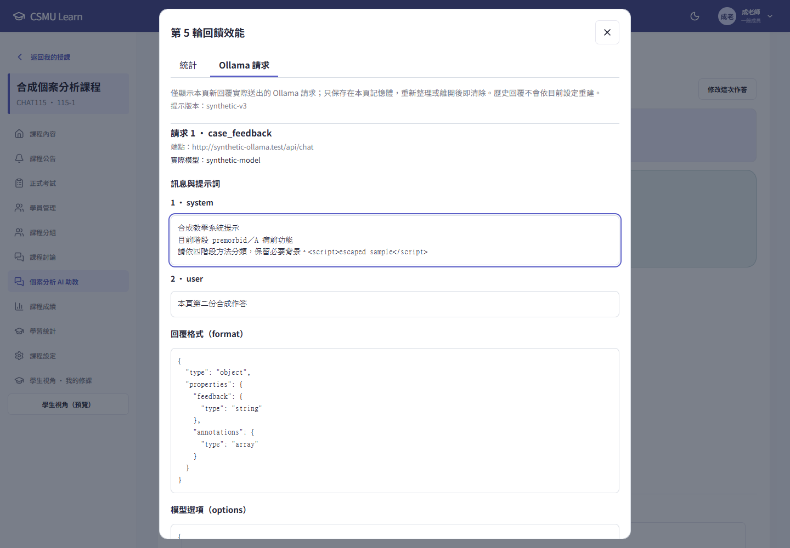
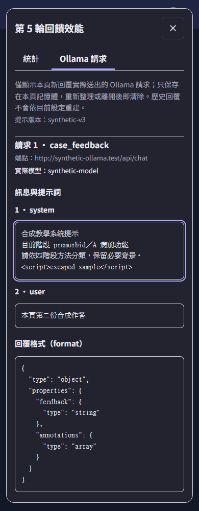

2026-11-20 現行診斷入口僅staff本人測試工作區，學生正式學習不顯示效能／Prompt／原始請求控制；正式審閱只看學生主動提交的快照，沒有讀取私人AI草稿／payload。原本頁記憶、無payload持久化、舊請求不重建規則保持。詳[交付](../case-analysis-2026-11-19-corrections.md)。

# 回覆效能與實際 Ollama 請求

## 2026-11-19 診斷圖示與模型提示

AI泡泡兩個文字入口改右側Gauge（回覆效能）／CodeXml（Ollama請求），具操作tooltip、鍵盤focus及讀屏名稱。Tooltip同時顯示當輪保存modelName；歷史缺模型時明示未記錄，不以目前profile猜測。User／assistant聊天訊息的model footer移除，模型仍可在效能dialog查看。沿既有canInspectRequests、capture／本頁記憶限制及原dialog分頁；沒有新增學生請求權限、持久化payload或修改模型封包。

## 2026-11-18 自動擴展速度刻度（取代固定上限）

速度量尺最低0–200 tok/s；本頁開啟回覆時，若需要更多空間，就以「速度／0.8，向上取50倍數」擴展上限，為最快讀數預留約20%或更多餘裕。例200→250、210→300、320→400（80%）。同頁已擴大的上限不隨較慢回覆縮小，以保持機器之間可比較；重新整理重設200。只留頁面數值記憶，不寫storage／DB，不改原量測數字。

刻度與讀屏上限一併更新，不再把超200速度截成滿格或提示溢位。仍僅效能dialog，無資料不畫條。相關Vue80、Chrome桌面淺色／手機深色、持續比較／刷新與原請求dialog8、Vite通過，7173已更新，無後端重啟。本節取代較早固定200描述。

## 2026-11-18 生成速度比較量尺

統計分頁的「生成速度」附固定0–200 tok/s條形刻度（0、50、100、150、200）。128.41 tok/s約填64.2%，方便本地機器之間比較；實際速度數字保留。超過200會滿格並顯示超出刻度提示，不裁成200。缺少／未量測的速度不畫條，量測0仍可顯示。量尺僅在效能dialog，以role=meter提供讀屏數值，不是模型執行進度或品質評分，200亦非硬體／API上限。模型、token計算、DB及payload保持。

相關Vue75、Chrome桌面淺色／手機深色及原請求dialog6、Vite通過；7173已更新前端，沒有服務重啟。

## 2026-11-17 generate原始prompt與多次呼叫

只有Omni聊天使用api/generate，dialog以安全文字顯示真正prompt（含Qwen role delimiters）、raw=true、format及options，JSON複製仍是實際body。其他模型仍顯示api/chat messages；不是推測服務內部token展開。Raw prompt無app system且帶同次LangChain完整成功歷史；Stage只帶目前phase system與當次作答。

長B若評語機械重複，可能有第二個case-feedback-repair請求，dialog保留兩份實際payload；統計明示ProviderCalls=2及合計量測，正式往返不是2。每輪顯示保存的實際模型，切下拉不會改舊回饋標籤。資料仍只在本人staff HTTPscope／本頁記憶，不入DB／log／storage、刷新不重建。詳[模型選擇與修正](model-selection.md)。

## 2026-11-17 本人失敗請求與原因

本課teacher／TA自己當次Stage／Raw錯誤，會顯示固定診斷碼、固定說明及可用的HTTP狀態；「查看失敗請求」直接開既有dialog的Ollama頁籤，顯示當次真正送出的payload。輸入預檢尚未送模型時沒有payload，不重建。沒有回覆量測時仍明示無量測。

完成後重新檢查課程角色，學生POV、只修課的教授、學生及已降權者均不提供；前端同步清除／隱藏。沿只留HTTPscope及頁面記憶、不入歷史／DB／log／storage的限制；不回傳任意上游error body、stack、inner exception或thinking。服務已知錯誤只轉固定分類，未知原因明說未取得，不把所有失敗叫模型拒答；舊failed紀錄不憑粗略failure_code重建詳細原因。

模式列已改為可鍵盤操作的頁籤，教師紀錄亦為授權頁籤；本次Vue288、Chrome30、完整隔離DB394通過，含新失敗payload與降權回歸。

更新：2026-11-17。課內「查看回覆效能」新增「統計／Ollama請求」分頁，供本課教師及TA檢視本人新回覆的實際請求。

## 操作

1. 重新整理，以教師／助教模式進入課內AI助教。
2. 在Raw或四階段送出新訊息，回覆後直接點「查看 Ollama 請求」；也可點「查看回覆效能 → Ollama請求」。僅本課教師／TA本人模式提供。
3. 查看實際模型、端點、依序訊息、format及options。單次「完整請求JSON／複製JSON」是實際HTTP body的payload，不是診斷wrapper；多次請求則明確標示payload陣列。
4. 選另一回饋輪次會顯示該筆回覆的擷取。舊紀錄、重新整理或離開模式後明示不可用，不以目前設定冒充原請求。

這是應用程式送到`/api/chat`的JSON，不是模型服務內部模板展開後的token紀錄，不包含私人thinking或HTTP憑證標頭。

2026-11-17修正：四階段payload只含目前階段system與本次user作答，舊草稿／AI回覆留DB而不再送入模型；Raw多輪不變。階段提示仍含共用分類代碼表，以辨識跨階段內容。長度預檢413拒絕時沒有送到Ollama的payload，不能假造。舊回覆／頁面重新整理後請送出新作答再查看。新的直接入口及兩則stage訊息已以桌面／手機淺深色測試，截圖更新。

## 授權與生命週期

實際課程教師／TA本人可檢視；平台教授若在該課僅為學生，仍不得擷取。學生、學生視角預覽及教師查閱他人學生歷程不提供此請求。模型呼叫前查課程資格、明確啟用request-scoped conversation capture，完成後重查staff角色；降權／退選不回傳。

擷取僅在本次HTTP scope及Vue頁面記憶體，不寫DB、Session、Redis、瀏覽器storage、一般log或diagnostics；模式、帳號、角色、學生視角、Raw清除／失效及頁面離開時釋放。Stage歷程／效能持久化不改，Raw仍無應用system／持久化／正式統計。冪等重送若未呼叫模型，不產生新擷取。

URL去掉使用者、密碼、query及fragment，payload遞迴移除thinking；conversation不擷取模型response body。三個profile、傳輸JSON與公開既有欄位不改，無Migration。

## 程式及驗證

- `Services/OllamaClient.cs`在真正序列化的HTTP body上擷取，沒有另組推測請求。
- `Services/OllamaRequestInspection.cs`只在request scope接受明確課程授權；Controller只在本人成功send／retry／Raw結果追加選用requestInspection。
- `CaseAnalysisChat.vue`按replyTo/requestId或Raw sessionId＋assistant位置配對，不把擷取放進messages／下一輪模型輸入。
- `ChatPerformanceDialog.vue`安全文字顯示、JSON複製、native dialog及頁籤鍵盤操作。

一般後端318通過／53外部DB條件略過，另隔離DB完整371/371且schema已刪；Vue273、Chrome22及標準VS含Vue通過。測試包含HTTP實際序列化比對、教師／TA／學生、教授在課內為學生、預覽、完成後降權、冪等重送、歷史不洩漏、DB無request wrapper、逐回覆及Raw清除。模型使用HTTP mock，本輪未實呼叫LLM、不宣稱教學品質驗收；原服務端可能留存資料的限制不變。

以下均為合成API資料，非正式病例／學生原文：

